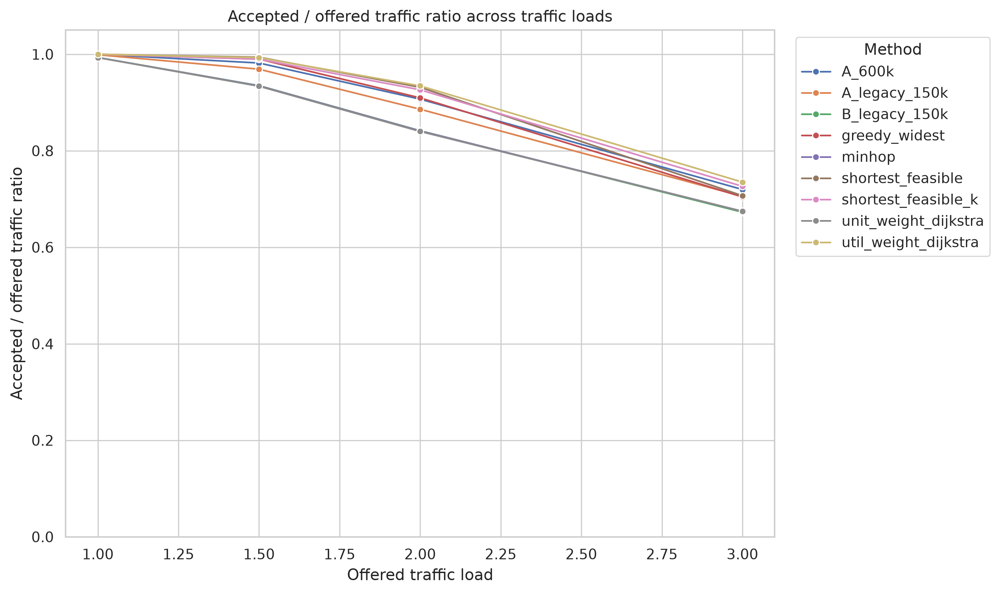
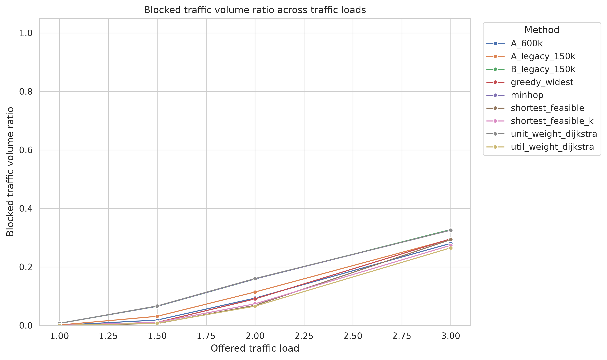
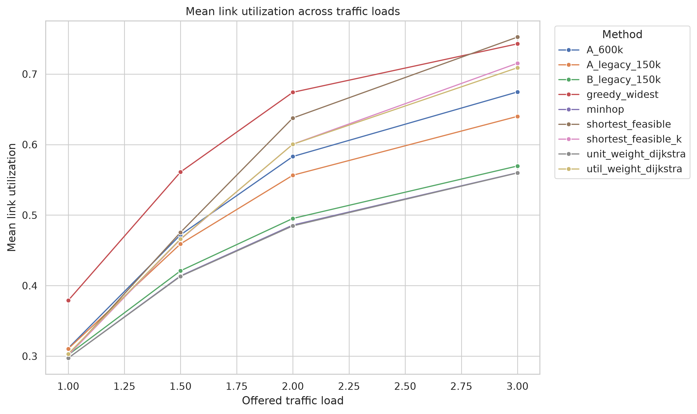
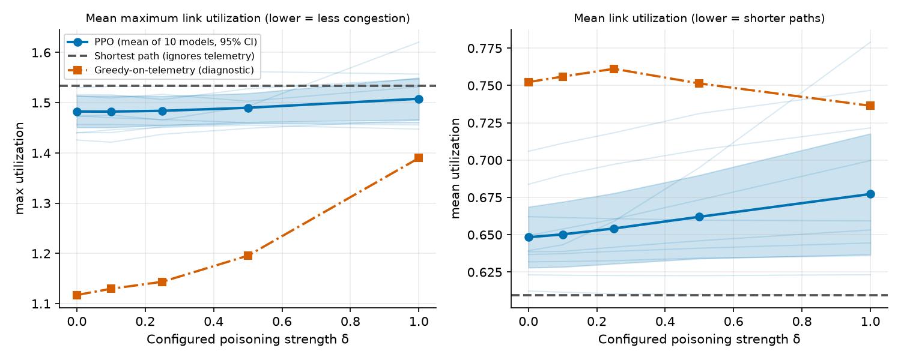
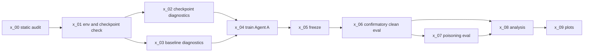

# RL_SEC: telemetry poisoning against RL-based routing (simulation study)

This repository studies whether corrupting the link-utilization telemetry that a reinforcement-learning (PPO) router reads can degrade its routing. Everything is simulation: a flow-level simulator on an NSFNET-style topology (14 nodes, 21 duplex links) with synthetic traffic. Phase 1 is an earlier prototype on an 8-node toy network. Phase 2 is a pre-specified validation pipeline.

**What is established (confirmatory tier).** On a frozen, fresh test set (500 scenarios x 4 traffic loads), the 600k-step Agent A (10 training seeds) accepts more traffic than min-hop routing at every load, accepts less than a shortest-feasible-path heuristic at loads 1.0 to 2.0, and more at load 3.0. Agent B is not distinguishable from unit-weight Dijkstra. These are clean-telemetry results only.

**What is still pilot.** No full poisoning run completed. The only completed poisoning evidence is a pilot (load 2.0 only, 100 scenarios, 3 training seeds per agent). In that pilot, random noise at the same budget degrades Agent A about as much as the targeted attacks, so the pilot does not show a targeted-attack effect beyond noise. Treat it as a pipeline check, not a finding.

This is research code and data, not a production tool. See "Responsible use".

## Status (plain text, no CI)

| Item | Run id | Status | Evidence |
|---|---|---|---|
| Clean confirmatory evaluation | `confirmatory_v1` | completed, 72,000 rows | `phase2/results/v2/confirmatory_v1/manifest.json`; CSV SHA-256 `e5257ccf...7f83b73` |
| Frozen checkpoints | - | 30/30 SHA-256 match | `phase2/results/deliverables/tables/checkpoint_verification.csv` |
| Poisoning smoke | `poison_smoke`, `x07_smoke_validation_20261031` | completed (pipeline check only; 126 rows in the latter) | `phase2/results/deliverables/audit/` |
| Poisoning pilot | `poison_pilot`, `poison_pilot_fresh` | completed, 16,500 rows; load 2.0 only | `phase2/results/deliverables/pilot_20261031/` |
| Poisoning full, optimized, reduced, seed-42 exploratory | `poison_full`, `poison_full_optimized`, `poison_A600k_reduced`, `poison_A600k_seed42_exploratory` | **failed** (manifests); not used | `phase2/results/deliverables/metadata/` |
| Tests | - | 75 passed in 12.91 s in one run (2026-10-31); an earlier run the same day had 4 failures. TODO(source needed: run `make test` on a fresh clone and record the result) | `docs/evidence/audits/` |
| Checksum verification | - | TODO(source needed: run `make verify` from the repo root and record the result) | `phase2/results/v2/SHA256SUMS.txt`, `MANIFEST_sha256.txt` |
| Code-tree hash vs freeze | - | **unresolved discrepancy** (see Limitations) | `phase2/results/v2/FINAL_AUDIT_REPORT.md` |
| Dataset provenance and license | - | **unresolved** | `phase2/data/PROVENANCE.md`, `DATA_LICENSES.md` |

## Key results

Status tags: **[confirmatory]** = pre-specified, run once after freeze. **[pilot]** = small, exploratory. **[phase 1]** = earlier prototype.
All effects are percentage points (pp) of accepted/offered traffic volume. Figure captions below describe the plotted metric; interpretation comes from the linked CSVs.



*Figure 1 [confirmatory, run `confirmatory_v1`]. Accepted/offered traffic ratio per method and load, clean telemetry, 500 fresh scenarios per load.*
Every method loses acceptance as load rises (e.g. Agent A 600k: 0.9998 at load 1.0, 0.7197 at load 3.0). Data: `phase2/results/confirmatory_v1/analysis_v2_valid_tests/summary_by_method_load.csv`.



*Figure 2 [confirmatory, run `confirmatory_v1`]. Blocked traffic volume ratio per method and load, clean telemetry.*
A secondary metric. No hypothesis test was pre-declared on it, so read it as descriptive. Data: `phase2/results/v2/confirmatory_v1/episodes.csv` (column `blocked_volume_ratio`).



*Figure 3 [confirmatory run, descriptive metric, run `confirmatory_v1`]. Mean link utilization per method and load, clean telemetry.*
Descriptive only. Mean utilization partly reflects path length, so lower is not automatically better routing. Data: same episodes file as Figure 2.



*Figure 4 [phase 1, toy 8-node network, 10 PPO models x 100 scenarios]. Performance of the Phase 1 PPO agent versus the poisoning strength delta.*
Phase 1 reported a small average effect that grows with delta and varies widely between models. It used a different, smaller simulator and a fixed two-link attacker. Data: `phase1/results/paired_effects_poisoned_minus_clean_ppo.csv`.

### Primary comparisons [confirmatory, `confirmatory_v1`]

Difference in mean accepted/offered ratio (pp). "p (Holm)" is from the revised v2 analysis, Holm-adjusted over 16 primary tests. Full CIs are in the source file.

| Comparison | Load 1.0 | Load 1.5 | Load 2.0 [95% crossed CI] | Load 3.0 | p (Holm) | Source |
|---|---|---|---|---|---|---|
| P1: A_600k minus shortest_feasible | -0.02 | -1.20 | -2.45 [-2.72, -2.18] | +1.28 | <= 1.3e-4 | `primary_comparisons_pp.csv` (v2) |
| P2: A_600k minus minhop | +0.66 | +4.73 | +6.58 [+6.22, +6.94] | +4.52 | <= 9e-10 | same |
| P3: B_legacy_150k minus unit_weight_dijkstra | +0.02 | +0.12 | +0.15 [-0.29, +0.56] | -0.18 | 1.0 (not rejected) | same |
| P4: util_weight_dijkstra minus unit_weight_dijkstra | +0.69 | +5.92 | +9.44 [+9.10, +9.78] | +6.05 | 8.0e-4 | same |

Source path: `phase2/results/confirmatory_v1/analysis_v2_valid_tests/primary_comparisons_pp.csv`. The original analysis is in `.../analysis/primary_comparisons_pp.csv` and gives the same point estimates and the same rejections.
Reading: A_600k beats min-hop everywhere, is worse than the shortest-feasible heuristic at loads 1.0 to 2.0 (the load-1.0 gap, 0.02 pp, is negligible), and better only at load 3.0. P3 shows no detectable difference, which is not proof of equivalence. P4 uses a heuristic selected on a separate development set; it is one deterministic method, so its inference is over scenarios only.

### Poisoning pilot [pilot, `poison_pilot_fresh`, load 2.0, 100 scenarios, 3 seeds per agent]

Change in accepted/offered ratio versus clean (pp), Agent A 600k: random_sign at eps 0.2 / 0.4: -1.80 / -4.56. conceal_topk: -1.70 / -4.07. fake_topk: +0.00 / -0.30. Agent B (legacy) stays within 0.6 pp of clean under every attack. The noise control (random_sign) is at least as harmful as the targeted attacks, so the pilot gives no evidence of targeted-attack success. Source: `phase2/results/deliverables/tables/pilot_attack_summary.csv`. The pilot has too few seeds for inference; its p-values and CIs were not pre-declared.

## Method at a glance

| Component | Description |
|---|---|
| Simulator | Flow-level admission on an NSFNET-bw topology (14 nodes, 21 duplex links, capacities 18 x 10 and 3 x 40 units). Synthetic traffic whose total offered volume at load 1.0 is calibrated to shipped samples; loads 1.5, 2.0, 3.0 are multiples. Primary metric: `accepted_offered_ratio` (accepted volume / offered volume; this is not packet delivery ratio). |
| Agents | PPO (Stable-Baselines3). `A_600k`: 10 seeds, 600k steps. `A_legacy_150k`: 10 seeds, 150k steps. `B_legacy_150k`: 10 seeds, 150k steps. Agent A picks among K=4 candidate paths; Agent B acts through a weighted-Dijkstra pipeline. |
| Baselines | minhop, shortest_feasible, shortest_feasible_k, greedy_widest, unit_weight_dijkstra, util_weight_dijkstra. minhop and unit_weight_dijkstra ignore telemetry. |
| Threat model | Test-time only. The attacker adds a bounded offset to the utilization the policy observes: `obs = clip(true + delta, 0, 1)`, `abs(delta_e) <= eps`. True loads, capacities, traffic, admission, reward and parameters are unchanged. Attacks: random_sign (noise control), bias_all_plus/minus, conceal_topk (-eps on the k=8 most-utilized edges), fake_topk (+eps on the k=8 least-utilized edges). Attacker knowledge: none for random and bias attacks; true utilization (for edge choice) for top-k attacks; no gradients, no adaptivity, no query feedback. eps grid {0.1, 0.2, 0.4} (pilot used {0.2, 0.4}). |
| Protocol | Development set `val_v2` for all tuning. Config and checkpoints frozen (`x_05`), then one confirmatory evaluation on fresh seeds 30,000,000 to 30,000,499 at loads 1.0, 1.5, 2.0, 3.0. Each load analysed separately. |
| Statistics | Effects in pp. Three intervals per comparison: scenario-only, across-model-seed t, crossed bootstrap (models and scenarios resampled), plus a Bonferroni-adjusted crossed CI. v2 tests: one-sample t-test over model-seed means (multi-model comparisons) or paired scenario sign-flip test (single-model comparisons). Holm adjustment over the 16 primary tests (P1 to P4 x 4 loads). |

Details: `phase2/docs/THREAT_MODEL.md`, `phase2/docs/02_EXPERIMENT_PROTOCOL.md`.



## Repository layout

Layout comes from the publish step; confirm against your tree before release.

```
README.md, CITATION.cff, DATA_LICENSES.md, Makefile, requirements.txt
MANIFEST_sha256.txt            checksums of published files
paper/                         paper sources (TODO(source needed): describe contents)
docs/
  DEVIATIONS.md                deviations from the pre-specified protocol
  RESULTS_INDEX.md             where each result lives
  WRITING_GUIDE.md             claims, number map, wording bank for the paper
  LARGE_FILES_NOT_INCLUDED.txt files kept out of git
  evidence/audits/             audit snapshots
  evidence/pre_freeze_restore/ post-freeze code snapshots (parts.py, sim.py)
phase1/
  originals/                   original prototype scripts and CSVs, with SHA256SUMS.txt
  audit/original_script_rerun/ re-run of the original script (seed 42)
  PHASE1_REPORT.md, PHASE1_STATUS.md
  src/, scripts/, tests/, results/, figures/   Phase 1 pipeline and outputs
  phase2/                      TODO(source needed): nested copy of Phase 2 files; resolve or remove
phase2/
  src/p2/                      simulator, environments, baselines
  src/p2x/                     validation pipeline: config, rollout, telemetry, stats, analysis
  scripts/x_00 ... x_09        pipeline stages
  tests/                       test suite
  configs/                     frozen experiment config
  docs/                        threat model, protocol, audits
  data/PROVENANCE.md           topology provenance (topology file itself not included)
  figures/                     diagnostic figures
  results/v2/                  freeze record, checkpoints audit, final figures
  results/confirmatory_v1/     both confirmatory analyses
  results/deliverables/        reports, manifests, tables, pilot outputs
```

## Reproduce

Environment. Python 3.12 was used for the audits. Checkpoints were trained under more than one PyTorch build (torch 2.14.1 and 2.11.0 are recorded), so bit-exact retraining is not expected.

```bash
python3 -m venv .venv && source .venv/bin/activate
pip install -r requirements.txt
make test        # test suite
make verify      # checksum verification of published evidence
```

TODO(source needed: `Makefile` targets; confirm `make test` sets the import paths for `p2` and `p2x`. Without them, pytest fails at collection with `No module named 'p2x'`.)

Obtain the topology yourself. `Network_nsfnetbw.ned` is not redistributed. Its recorded SHA-256 is `fe497b0bce187d1b7fe454e92c8778357dfa21ef2587878723d7d43d52824e7e`; the scripts refuse to run on any other file. Place it where `phase2/data/PROVENANCE.md` says.

Pipeline order (run from `phase2/`; see `phase2/docs/02_EXPERIMENT_PROTOCOL.md` for flags):

```bash
python scripts/x_00_static_audit.py
python scripts/x_01_check_env_and_checkpoints.py
python scripts/x_02_diag_checkpoints.py --agent replace      # and --agent enhance
python scripts/x_03_diag_baselines.py
python scripts/x_04_train_agent_a.py --preset pilot --run    # then all seeds
python scripts/x_05_freeze.py --yes                          # voids any later config edit
python scripts/x_06_confirmatory_eval.py
python scripts/x_08_analyze.py --stage confirmatory
python scripts/x_07_poison_eval.py --preset smoke --run      # then pilot / full
```

Runtimes. The recorded confirmatory evaluation took 1842.8 s (about 31 minutes) on the author's machine. Protocol estimates for other stages are extrapolations, not measurements. TODO(source needed: measured runtimes for x_04, x_07 pilot).
Large files not in git (for example a 45 MB poisoning merge-staging CSV) are listed in `docs/LARGE_FILES_NOT_INCLUDED.txt`. Trained checkpoints: TODO(source needed: state whether `.zip` checkpoints are in the repo).

## Limitations and deviations

Full list: `docs/DEVIATIONS.md`.

- **Statistics revised after the result.** The original analysis reported a resampling p-value (`p_boot`). A second analysis, `analysis_v2_valid_tests`, replaced it with a t-test over model-seed means or a paired sign-flip test. The output column is still named `p_boot`; it is not a bootstrap p-value in v2. This was a post-hoc correction. Point estimates and all reject/not-reject decisions are the same in both analyses.
- **Code edited after the freeze.** `phase2/src/p2/sim.py` and `phase2/src/p2x/parts.py` were modified after the freeze; snapshots are in `docs/evidence/pre_freeze_restore/`. The recorded core-code hash (`2164ee0a...`) does not match recomputed hashes, and an attempt to reconstruct the frozen source failed. This is unresolved. Do not read the results as exactly code-reproducible.
- **Pilot is not a full run.** Four larger poisoning runs failed. The pilot covers one load and three seeds per agent.
- **Simulator realism.** Synthetic traffic, flow-level admission, one topology, load calibration verified only for total offered volume at load 1.0. No real-network claims.
- **Mixed training builds.** Checkpoints came from multiple PyTorch builds.
- **Licensing.** Topology identity and license are unverified; no `LICENSE` file has been chosen for the code yet.

## Data and licenses

- Code license: **undecided**. Until a `LICENSE` file is added, no reuse rights are granted. TODO(source needed: decision).
- Not redistributed; cite the originals: ENERO, Topology Zoo, RouteNet datasets, `nsfnet-v4.tar.gz`, and the NSFNET-bw topology file. See `DATA_LICENSES.md` and `phase2/data/PROVENANCE.md`.
- A BSD-3 notice for the third-party fork that supplied the topology file is kept at `phase2/data/raw/nsfnetbw_fork/LICENSE_fork_BSD3.txt`. It may not cover the data.

## Citation

See `CITATION.cff`. TODO(source needed: fill title, authors, version, and paper reference).

## Responsible use

This repository studies attacks on learned routing in order to measure and eventually reduce that risk. Scope: simulated networks, non-adaptive attackers, test-time telemetry corruption only. It does not provide attack tooling for real networks, and its results do not show that any deployed system is vulnerable or safe. Use it for defensive evaluation of systems you own or are authorized to test.

## Contact and acknowledgements

TODO(source needed: maintainer contact, funding, acknowledgements).
